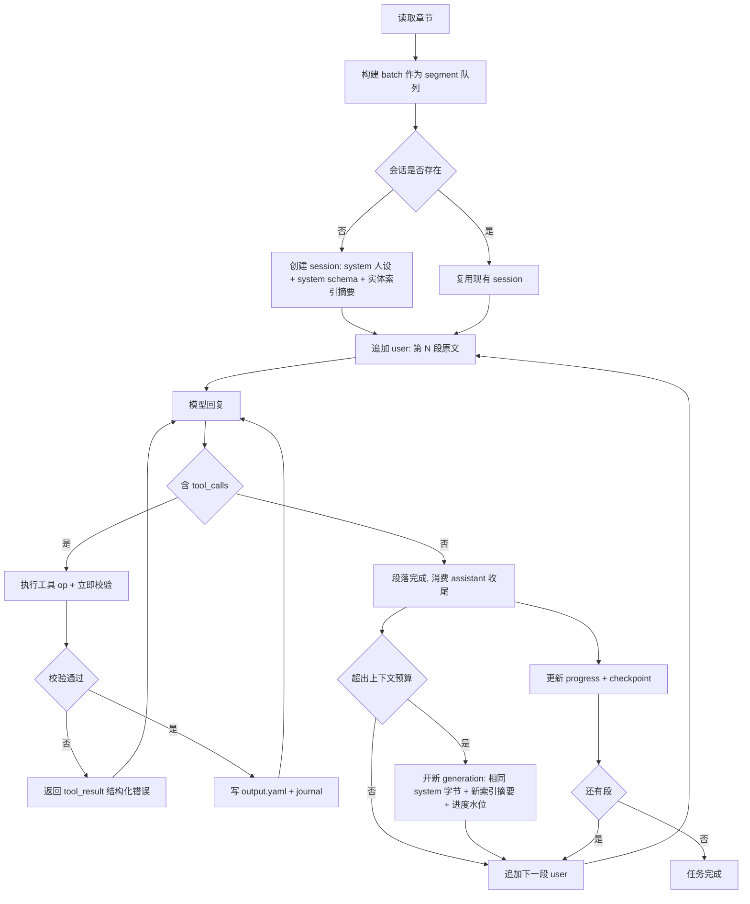

# Agent 编辑式抽取与连续会话重构方案

## 目标

把现有「每批次整段生成 YAML + 程序侧启发式合并」的管线，改造成 Agent 工作方式：

1. **不再让 LLM 输出全文 YAML**：改为给模型提供一组编辑工具，让模型通过工具调用修改当前任务的 `output.yaml`（任务隔离，只改局部），从根本上避免长输出撞 `max_tokens`。
2. **缓存友好的连续会话**：schema 等静态内容作为 system 前置块只出现一次；分段（segment）之间只 append 新消息，不重写前缀；一段的编辑全部完成后（无后续工具调用）再喂下一段原文，保留上下文以提升前缀缓存命中率。
3. **确定性校验接管模型自述**：每次工具调用后立刻校验，把结构化错误回给模型局部修复，取代现在「整批次重试 + 两个全量重试模板」的粗粒度回退。

本方案不改变已有的工作区隔离、checkpoint、进度落盘、公平调度等外部约定。

---

## 现有实现观察

### 运行主流程

- 任务入口在 [`TaskRunner.run_task()`](src/task_runner.py:63)，分批执行入口在 [`TaskRunner._run_batch()`](src/task_runner.py:261)
- 单个批次从 `_run_batch` 内部完成「构建 prompt → 流式接收 → 解析 → 清洗 → 校验 → 合并 → 写盘」
- 批次拆分由 [`TaskRunner._run_batch_single()`](src/task_runner.py:434) 返回 `needs_split`，由 [`TaskRunner.step_task()`](src/task_runner.py:113) 决定入队
- 提示词拼装在 [`PromptBuilder.build()`](src/prompt_builder.py:9)，模板在 [`prompts/base.md`](prompts/base.md)、[`prompts/retry_format.md`](prompts/retry_format.md)、[`prompts/retry_schema.md`](prompts/retry_schema.md)
- 模型调用在 [`OpenAICompatibleStreamModelClient.stream_yaml()`](src/llm_client.py:53)，payload 由 [`build_chat_completions_payload()`](src/llm_client.py:108) 构造
- 合并与写盘在 [`YamlStore.merge_increment()`](src/yaml_store.py:48)，数组合并启发式在 [`SmartArrayMerger.merge_arrays()`](src/smart_array_merger.py:33)

### 现状问题

**问题 1：输出必须包含完整节点，撞 max_tokens**

[`prompts/base.md`](prompts/base.md) 第 16 行要求「但凡输出了某个角色或设定，对应条目内容必须完整输出，不能缺失之前已有字段」，而 [`PromptBuilder.build_output_rules()`](src/prompt_builder.py:62) 又写着「允许只返回新增或更新过的字段，不需要返回完整节点」。两处规则互相冲突，实际行为取决于模型：一旦模型选择完整输出，单个角色节点（含 `appearance`、`outfits`、`personality_core`、多层嵌套 list）就是数 KB。同时 `schemas/characters.yaml` 注释极重，schema 本身约 2537 tokens 输入。配置里 `batching.reserve_output_tokens` 只有 3000，输出被截断是必然结果。

**问题 2：前缀缓存命中率为 0**

[`PromptBuilder.build()`](src/prompt_builder.py:9) 把 `existing_yaml`（当前 output 全文）、`existing_worldinfo`、`source_text` 全部塞进同一条 user message。每批次的 `existing_yaml` 都不同，且位于 prompt 中部，导致：

- schema 块虽然每次内容相同，但它排在 `existing_yaml` 之后，前缀被破坏，无法作为缓存前缀单元复用
- 唯一被请求的是「完整的 user message」，每批都不同，等价于全量 cache miss
- 长尾更严重：`existing_yaml` 随进度单调增长，单批 prompt 越来越长

**问题 3：合并语义被启发式替代**

[`YamlStore._merge_node()`](src/yaml_store.py:86) 对 dict 递归合并、对 list 交给 [`SmartArrayMerger`](src/smart_array_merger.py:17)（相似度阈值 0.6）猜「是不是同一个元素」。既然输出是整节点替换，这套相似度逻辑只是在替模型猜身份，既不可解释也不可控，且与「整节点替换」注释语义不符。

**问题 4：校验是空实现**

[`SchemaValidator.validate_increment()`](src/schema_validator.py:65) 只有一行 `# TODO: JSON Schema validator` 后直接 `return ValidationResult(ok=True)`；已经写好的 [`_validate_against_skeleton()`](src/schema_validator.py:78) 从未被调用。因此「schema 结构错误」目前无法被系统检测，只能靠模型自述或人工发现。

**问题 5：与有状态会话冲突的调度行为**

[`TaskRunner.step_task()`](src/task_runner.py:113) 在批次拆分时执行 `pending_batches.append(left); append(right)`，把子批次排到队列**尾部**，即后续未处理章节会先于失败段执行。单批独立调用时这没问题；连续会话模式下会直接打断消息时间线（会话要求严格按章节顺序推进），必须改为按序回灌。

**问题 6：重试模板成本高**

三个模板（base / retry_format / retry_schema）各自都内嵌 schema + 原文 + 已有结果，整批次重跑一次就是一次完整重算，重试 3 次等于 4 倍成本，且每次都换 prompt 前缀（进一步摧毁缓存）。

### 基线测试现状

`python -m unittest discover -s tests` 当前 **75 项中 4 项失败**，属于重构前既有状态，不是本方案引入：

| 失败测试 | 行号 | 根因 |
|---|---|---|
| `test_validate_increment_rejects_missing_match_key` | [tests/test_pipeline.py:225](tests/test_pipeline.py:225) | 问题 4：`validate_increment` 空实现 |
| `test_validate_increment_rejects_unexpected_top_level_key` | [tests/test_pipeline.py:240](tests/test_pipeline.py:240) | 问题 4 |
| `test_validate_increment_rejects_unexpected_field` | [tests/test_pipeline.py:249](tests/test_pipeline.py:249) | 问题 4 |
| `test_merge_increment_replaces_lists_as_a_whole` | [tests/test_pipeline.py:446](tests/test_pipeline.py:446) | 问题 3：数组改为智能合并后，语义从「整替」变成「相似替换+追加」 |

前 3 项在本方案第 1 步（接通校验）后应自然转绿；第 4 项需要用显式测试替换，或明确保留智能合并语义，见「测试方案」。

### 规模数据（实测）

以 `input/` 下实际 epub 为例（[_extract_epub()](src/epub_reader.py:19)，token 估算除数为 4，见 [`estimate_tokens()`](src/epub_reader.py:176)）：

- 章节数：**937**
- 正文字符数：3,108,049（约 **777,012** estimated tokens）
- 单章中位字符数：3,080（约 770 tokens）

按当前 `batching.max_input_tokens=32000` / `prompt_overhead_tokens=1500` / `reserve_output_tokens=3000`，[`chapter_token_budget`](src/models.py:275) = 27,500，即单批约 6750 字符正文——每本书约 460 个批次。每个批次都重发 schema（2537 tok）+ 全文 `existing_yaml`，这就是成本与超长的来源。

---

## 需求边界

### 本方案包含

- LLM 侧工具集（读取/写入当前任务 output.yaml 的结构化编辑接口）
- 连续会话的消息布局、段落驱动、上下文旋转
- 缓存命中观测（DeepSeek `prompt_cache_hit_tokens` / `prompt_cache_miss_tokens`）
- 逐步确定性校验与工具级错误反馈
- 失败段回灌、拆分语义调整
- `pipeline.mode` 开关，保留 legacy 路径
- 相应的配置、进度字段、测试与文档变更

### 本方案不包含

- 不引入 LangChain / LangGraph
- 不改工作区隔离规则、不改 checkpoint 文件布局
- 不做多 epub 之间的实体全局消歧（仍是任务内隔离）
- 不实现 JSON Schema 完整校验器（只做 skeleton 校验，见下）
- 不改 UI / 控制台输出的展示格式

---

## 设计总览



---

## 工具集设计

### 设计取舍：结构化 patch 而非 str_replace

不采用 `str_replace` 风格的文本编辑工具。原因：目标文件是几十 KB 的 YAML，模型需要在 `oldText` 中精确复现缩进、中文、转义；一旦不匹配就整次失败，且失败信息（「未找到该片段」）对模型没有可执行的修复方向。

改用**结构化操作**：模型给出的是 key / 字段路径 / 新值，由程序解析路径、执行修改、回写文件。路径不匹配时，错误信息可以直接列出真实存在的 key 与候选路径。

### 工具清单

所有工具作用于当前任务（task）隔离的 `output.yaml`，即 `<workspace>/output/<schema>.yaml`。

| 工具 | 参数 | 语义 |
|---|---|---|
| `read_entry` | `key: string`, `path?: string` | 读取指定条目或其中某个字段的当前值。`upsert`/`set_fields` 前建议先读 |
| `list_entries` | `prefix?: string`, `limit?: int` | 列出当前 root 下的 key（含一行摘要），用于重名检查 |
| `upsert_entry` | `key: string`, `node: object` | 条目不存在则新建；存在则按字段深合并覆盖。**不允许整表替换** |
| `set_fields` | `key: string`, `path: string`, `value: any` | 设置单个深层字段，路径用点号分隔；数组下标用 `[i]` |
| `append_items` | `key: string`, `path: string`, `items: array`, `mode?: "append_unique" \| "append"` | 追加数组元素，默认去重（字符串按完全相同、对象按主键字段判断） |
| `remove_field` | `key: string`, `path: string` | 删除字段。受 `tools.allow_remove` 控制，默认 false |
| `remove_entry` | `key: string` | 删除整个条目。受 `tools.allow_remove` 控制，默认 false |

### 工具执行契约

每次工具调用按以下顺序执行，任一步失败即返回 `tool_result` error 且**不改文件**：

1. **路径解析**：root key 必须等于 `schema_definition.root_key`；`key` 必须符合 `[A-Za-z0-9_]+`（对应「禁止使用中文 key」规则）
2. **重名检查**（仅 `upsert_entry` 新建分支）：与现有 key 求相似度，超过 `merge.similarity_threshold`（默认 0.6）时拒绝，返回候选 key 列表。复用 [`SmartArrayMerger._find_best_match()`](src/smart_array_merger.py:59) 的相似度实现，不再用它做合并
3. **skeleton 校验**：用 [`_validate_against_skeleton()`](src/schema_validator.py:78) 校验新节点——字段必须存在于 schema、类型匹配、`match_key` 字段有意义
4. **必填与黑名单**：必填字段（`avatar` 之外的最小集，见 schema 注释中「必须」标记）非空；值中不得出现 [`blacklist_keywords`](config.yaml) 及 base 模板列出的无意义占位词
5. **原子写**：写入临时文件 → `os.replace` 覆盖 → 追加 journal 记录（含 pre-image）
6. **返回**：`{ok: true, stats: {created|updated|fields_changed}, doc_size}`

失败返回形如：

```json
{"ok": false, "error": {"code": "unknown_field", "path": "actors.Alice.appearance.hair_color",
 "reason": "field not present in schema skeleton",
 "allowed_siblings": ["physical_description", "outfits"],
 "suggestion": "put coloring into appearance.physical_description"}}
```

错误信息必须包含**可执行的下一步**（允许的兄弟字段、候选 key、期望类型），这是替代「整批重试」的关键。

### 为什么不用工具调用输出整份 YAML

保留一个 `write_full_yaml` 工具作为逃生口是可行的，但默认禁用：一旦启用就会退回「输出全文」，缓存与 max_tokens 问题同时回归。若确需（例如初始骨架生成），限定 `tools.allow_full_write: false` 且只在 generation 的首段开放。

---

## 会话消息布局与缓存策略

### 缓存机制约束（已核实）

- **DeepSeek**：磁盘上下文缓存默认开启，按**完整前缀单元**匹配；前缀单元在「用户输入结束位置」「模型输出结束位置」「多请求公共前缀」「固定 token 间隔」四处被持久化。命中要求**逐字节完全匹配**。官方明确是 best-effort，不保证 100%。
- **OpenAI**：≥1024 tokens 的 prompt 自动启用，前缀匹配，无需改代码。
- **Anthropic**：需显式 `cache_control` 断点，顺序为 tools → system → messages，最多 4 个断点。

结论：**消息前缀必须逐字节稳定**，且缓存效果只能作为观测指标，不能作为正确性断言。

### 消息布局（append-only）

```
[0] system     : 人设 + 输出规则 + 工具使用说明（常量，跨 generation 完全相同）
[1] system     : schema 全文 + 字段说明（常量，约 2537 tok，第一个大缓存块）
[2] user       : 实体索引摘要（key 列表 + 一行描述，不含全文；每 generation 仅一次）
[3] assistant  : 收尾消息（无 tool_calls），标记段开始前的基线
--- 段循环开始 ---
[4] user       : 第 N 段原文（仅追加这一条，不重写历史）
[5] assistant  : tool_calls[]（可多轮）
[6] tool       : tool_result
[7] ...        : 重复 5-6 直到无 tool_calls
[8] assistant  : 无 tool_calls 的收尾消息  ← 段完成信号
--- 追加下一段 ---
[9] user       : 第 N+1 段原文
```

硬性规则：

1. **段落必须跑完工具循环**（assistant 停止发出 `tool_calls`）才允许追加下一段；否则消息交错，前缀断裂
2. **绝不在 user message 中放 output.yaml 全文**。这是当前缓存全废的直接原因；模型靠上下文记忆 + `read_entry` 按需读取
3. **schema 只在 `[1]` 出现一次**，不再每批重复
4. **删除 `existing_worldinfo` 注水**：world 是独立任务（[`_load_existing_worldinfo()`](src/task_runner.py:578) 读的是另一个 schema 的产物），在 agent 模式下没有意义
5. **消息一旦追加不再编辑**。若某段需要重试，作为**新段落**追加新 user 消息（携带失败原因），而不是改写历史消息

### 前缀稳定性验证方法（必须做）

单元测试：连续追加 3 段后，断言「第 N 次请求序列化后的消息前缀字节」是「第 N+1 次请求前缀字节」的严格前缀：

```
serialize(messages_k) == serialize(messages_{k+1})[:len(serialize(messages_k))]
```

这是可在 CI 中断言的确定性性质，比依赖 API 返回的命中 token 数可靠。

---

## 上下文旋转与预算

### 旋转触发

- 累计 `prompt_tokens`（用 `usage` 实测，退化时用 `estimate_tokens()`）超过 `session.max_context_tokens` 时开新 generation
- 旋转点**对齐 checkpoint 窗口**（[`checkpoint_every_n_chapters`](config.yaml)，窗口计算见 [`TaskRunner._chapter_window_index()`](src/task_runner.py:525)），保证可复现、可回滚
- 新 generation 的消息列表为：`[0][1]`（**字节完全相同**）+ 新的实体索引摘要 + 一行进度水位（`已处理至 chXXXX`）
- 因为 `[0][1]` 不变，新一代仍能命中 system+schema 的公共前缀缓存

### 预算重算

| 参数 | 现取值 | 建议值 | 理由 |
|---|---|---|---|
| `batching.reserve_output_tokens` | 3000 | 1000 | 单次回复只需容纳 tool_call 参数（一次 op 数十~数百 token） |
| `batching.prompt_overhead_tokens` | 1500 | 1800 | 增加工具说明与规则文本 |
| `session.max_context_tokens` | — | 64000 | 旋转阈值，需大于单段正文 + 索引摘要 + 历史 op 往返 |
| `session.max_tool_rounds_per_segment` | — | 12 | 超限视为该段失败 |
| `session.rotate_on_checkpoint` | — | true | 旋转与 checkpoint 对齐 |

### 单段大小

agent 模式下 `chapter_token_budget` 不必再为「历史全量 output」留位，单段可容纳更多章节。建议保留现有 [`_build_initial_batches()`](src/task_runner.py:203) 的组装逻辑（窗口边界 + token 预算 + oversize 单章），只把 `reserve_output_tokens` 调小。

---

## 配置设计

在 [`AppConfig`](src/models.py:280) 下新增两个配置节，建议放在 `model` 之后：

```yaml
pipeline:
  mode: agent          # agent | legacy

session:
  enabled: true
  max_context_tokens: 64000
  max_tool_rounds_per_segment: 12
  rotate_on_checkpoint: true
  persist_messages: true          # 落盘 session/messages.jsonl，支持 resume
  index_detail: compact           # compact | full

tools:
  allow_remove: false
  allow_full_write: false
  near_duplicate_check: true

cache:
  mode: implicit        # implicit(DeepSeek/OpenAI) | explicit(Anthropic cache_control)
  log_hit_tokens: true
```

说明：

- `pipeline.mode` 是总开关，未设置时默认 `legacy`，保证行为不回退
- `session.max_context_tokens<=0` 视为不旋转（等价于当前「一次跑完一本书」的上下文占用，仅用于短书调试）
- `cache.mode` 必须在配置层决定，不能在 [`llm_client.py`](src/llm_client.py) 里写死

同步修改：

- [`load_config()`](src/app.py:37)
- [`default_raw_config()`](src/app.py:102)
- [`config.example.yaml`](config.example.yaml)
- [`README.md`](README.md) 配置章节

---

## 存储布局

在现有 [`WorkspacePaths`](src/models.py:78) 基础上新增 `session/` 目录：

```
<workspace_root>/<epub_slug>/
  source/                 # 不变
  output/
    <schema>.yaml         # 唯一真相（agent 模式的写入目标）
  state/
    <schema>.progress.yaml
  checkpoint/             # 不变
  temp/                   # 不变
  logs/
    run.log
    debug/                # 现有 prompt/response 快照
  session/                # 新增
    <schema>/
      messages.jsonl      # append-only 会话消息（含 generation 边界标记）
      journal.jsonl       # 每次 op 的 pre-image + post-image + 校验结果
      index.yaml          # 当前 generation 的实体索引摘要快照
      meta.yaml           # generation id / 起始章节 / 累计 usage / 旋转原因
```

约定：

- `messages.jsonl` 每行一条消息 + 元数据（generation、segment 起止章节、是否 tool_call），崩溃后可从最后一条完整记录恢复
- `journal.jsonl` 支持单段撤销；`CheckpointStore` 只需额外复制 session 目录，**[`save_checkpoint()`](src/checkpoint_store.py:13) 的既有逻辑不改**
- 每个 `<schema>` 独立子目录，天然与任务隔离规则一致

---

## 运行时设计

### 段落循环（替换 `_run_batch`）

[`TaskRunner._run_batch()`](src/task_runner.py:261) 拆为：

- `_run_segment(state, segment)`：单段落完整执行（追加 user → 工具循环 → 收尾 → 校验 → 推进进度）
- `_drive_session(state)`：段落循环 + 旋转判断 + checkpoint

单段落内部：

```
1. 取会话（不存在则新建）
2. 构造段原文消息，append 到 messages
3. 循环 max_tool_rounds_per_segment 次：
   a. complete_with_tools(messages, tool_schemas)
   b. append assistant 消息（含 tool_calls）
   c. 无 tool_calls → 跳出循环
   d. 对每个 tool_call：edit_tools.apply_ops()，append tool_result
4. 判断段结果：
   - 无任何 op 且无收尾消息 → 段失败（模型空转）
   - 达到轮数上限 → 段失败
   - 存在未修复的校验错误 → 段失败
5. 成功：更新 progress、写 checkpoint（按原边界）、清理 temp
```

### 拆分与失败回灌（修正调度冲突）

- [`step_task()`](src/task_runner.py:113) 中 `pending_batches.append(...)` 改为 **`appendleft`**，且右半段并入左半段之后（保持章节顺序），配合把失败段重新插入会话
- 段失败时的重试，改为**在同一会话中追加新 user 消息**（携带结构化失败原因），而不是新建 prompt 重跑整批
- `_should_split_batch()` 的判定保留，但拆分后两个子段仍按序、在同一会话中执行

### 缓存观测落盘

- [`stream_yaml()`](src/llm_client.py:53) → 新增 `complete_with_tools()`，payload 增加 `stream_options: {include_usage: true}`，流式累积 `tool_calls` 的 `index` / `id` / `function.name` / `function.arguments` 增量
- 每次响应把 `usage` 写入 `progress.cache`：`{prompt_tokens, cache_hit_tokens, cache_miss_tokens, completion_tokens, hit_ratio}`
- 命中率只做**观测与展示**，不参与正确性判定

---

## 校验与错误反馈

### 接通 skeleton 校验

[`SchemaValidator.validate_increment()`](src/schema_validator.py:65) 从空实现改为：

- 调用现有 [`_validate_against_skeleton()`](src/schema_validator.py:78)，补齐当前缺失的三类错误：
  - root 下出现非预期顶层 key
  - 条目缺少 `match_key`（[`required_item_keys`](src/models.py:206)，注意 schema loader 里 `worldinfo` 也映射到 `name`，与 schema 注释不一致，需一并确认）
  - 条目出现 schema 外字段
- 保留 `sanitize_increment_data()` 的清洗顺序：先清洗再校验（现有测试依赖该顺序）

### 路径级校验供工具复用

新增 `validate_node(node, path, schema_definition) -> ValidationResult`，供 [`edit_tools.apply_ops()`](src/edit_tools.py:1) 在校验单节点时调用，避免为了改一个字段而验证整份文档。

### 黑名单与占位值

[`_check_blacklist()`](src/task_runner.py:637) 现有实现是对**整段响应文本**做子串匹配——在工具模式下响应里含工具参数，容易误伤。改为对**提交的字段值**逐值检查。

---

## 进度模型与缓存观测

在 [`ProgressStore`](src/progress_store.py:12) 上扩展（不改现有字段语义）：

- `session: {generation_id, segments_completed, last_segment_end_chapter, rotate_count}`
- `cache: {prompt_tokens, cache_hit_tokens, cache_miss_tokens, hit_ratio}`（累计）

维护规则：

- 单段成功才更新 `last_segment_end_chapter`；失败段不推进 `last_completed_chapter_index`（由 [`mark_batch_completed()`](src/progress_store.py:152) 负责）
- 旋转时 `generation_id` 自增、`rotate_count` 自增、`last_segment_end_chapter` 保持不变

---

## 组件建议

| 新增组件 | 职责 |
|---|---|
| `src/edit_tools.py` | 工具 JSON Schema 定义、`apply_ops(doc, ops, schema_definition)`、路径解析、去重、近似重名检查、原子写与 journal |
| `src/session.py` | `ExtractionSession`：append-only 消息列表、段落驱动、token 记账、旋转、`messages.jsonl` 持久化与恢复 |
| `src/index_builder.py` | 从 `output.yaml` 生成实体索引摘要（key + 一行描述，`index_detail` 控制粒度） |
| `prompts/agent_system.md` | 新的稳定 system 文本（人设 + 输出规则 + 工具使用说明），去掉 `existing_yaml` / `source_text` / 「必须完整输出」等与工具模式冲突的规则 |

避免把工具实现堆进 [`TaskRunner`](src/task_runner.py:37) 或 [`app.py`](src/app.py:1)，与 checkpoint 方案的分层思路保持一致。

---

## 影响点清单

### 配置与模型

- [`BatchingConfig`](src/models.py:263)：`reserve_output_tokens` 默认值调整
- [`AppConfig`](src/models.py:280)：新增 `pipeline` / `session` / `tools` / `cache` 四个配置节
- 新增 `SessionConfig` / `ToolConfig` / `CacheConfig` dataclass
- [`load_config()`](src/app.py:37)、[`default_raw_config()`](src/app.py:102)、[`config.example.yaml`](config.example.yaml)

### 工作区与存储

- [`WorkspacePaths`](src/models.py:78)：新增 session 目录与命名辅助方法
- 新增 `src/session.py`、`src/edit_tools.py`、`src/index_builder.py`

### 运行逻辑

- [`TaskRunner._run_batch()`](src/task_runner.py:261)：拆为 `_run_segment` / `_drive_session`
- [`TaskRunner.step_task()`](src/task_runner.py:113)：拆分入队改 `appendleft`，段失败回灌同会话
- [`TaskRunner._build_initial_batches()`](src/task_runner.py:203)：预算参数随配置变化
- [`TaskRunner._load_existing_worldinfo()`](src/task_runner.py:578)：agent 模式下不再使用
- [`PromptBuilder.build()`](src/prompt_builder.py:9)：agent 模式走新路径，不再拼接 `existing_yaml`

### 模型调用

- [`OpenAICompatibleStreamModelClient`](src/llm_client.py:39)：新增 `complete_with_tools()`，支持 tool_calls 流式累积与 `usage`
- [`build_chat_completions_payload()`](src/llm_client.py:108)：扩展为接受 messages 列表与 tools 参数
- [`StreamModelClient`](src/models.py:330) Protocol：新增方法签名

### 校验与存储

- [`SchemaValidator.validate_increment()`](src/schema_validator.py:65)：接通 skeleton 校验
- [`YamlStore`](src/yaml_store.py:17)：新增 `upsert_entry` / `set_field` / `append_unique` / `read_path`；[`merge_increment()`](src/yaml_store.py:48) 保留给 legacy
- [`ProgressStore`](src/progress_store.py:12)：新增 session / cache 元数据

### 命令行入口

- [`build_parser()`](src/app.py:317)：可选新增 `session` 子命令（查看会话状态/命中率、导出 messages）
- [`main()`](src/app.py:345)

### 测试与文档

- [`tests/test_pipeline.py`](tests/test_pipeline.py)：新增工具、会话、缓存前缀、旋转用例；修正 4 项基线失败
- [`README.md`](README.md)：配置说明、运行模式说明

---

## 测试方案

### 1. 校验回归（第 1 步就应转绿）

- 三个 `validate_increment_*` 失败用例必须通过
- [`test_merge_increment_replaces_lists_as_a_whole`](tests/test_pipeline.py:446) 需明确取舍：agent 模式下 `append_items` 语义已是显式追加，legacy 的数组语义用新测试重写

### 2. edit_tools 单元测试

- `upsert_entry` 新建 / 更新 / 深合并；非法 key 被拒
- `set_fields` 深层路径、数组下标路径、路径不存在时的错误信息包含候选
- `append_items` 去重（字符串完全相同 / 对象主键相同）
- 近似重名拒绝并返回候选列表
- 校验失败时**文件未被修改**（原子性）
- journal 记录可回放，pre-image 可用于撤销单次 op

### 3. 会话与前缀稳定性

- 消息 append-only：段间追加后，旧消息对象身份不变
- **前缀严格性断言**：第 N 次请求序列化字节是第 N+1 次的严格前缀
- system 块跨 generation 字节相同
- 工具循环轮数超限 → 段失败，且 `last_completed_chapter_index` 未推进

### 4. 旋转

- 超过 `max_context_tokens` 触发新 generation，`generation_id` 自增
- 旋转点落在 checkpoint 窗口边界
- 旋转后 system 块字节不变（可继续命中公共前缀）

### 5. 回灌与顺序

- 段失败拆分后，子段按章节顺序执行（不是排到队尾）
- 段失败重试是**追加新消息**，历史消息不被改写

### 6. 端到端（含缓存观测）

- 用 echo 客户端（[`EchoStreamModelClient`](src/llm_client.py:30)）跑通完整段落循环，验证输出文件与 progress 一致
- 真实 API 跑一次长书：记录 `cache_hit_tokens / prompt_tokens` 稳态值，以及单段输出 token 对比 legacy 的下降幅度

### 7. 兼容性

- `pipeline.mode: legacy` 时全部现有测试行为不变（除已修 3 项）
- 未设置 `pipeline` 配置节时默认 legacy

---

## 实施步骤

- [x] **步骤 1：校验回真**。接通 [`validate_increment()`](src/schema_validator.py:65) 到 [`_validate_against_skeleton()`](src/schema_validator.py:78)，修正 3 个失败测试；数组语义测试按 `plans/yaml-array-merge-design.md` 的实际语义重写
- [x] **步骤 2：编辑工具**。新增 [`edit_tools.py`](src/edit_tools.py) 与单元测试（apply / 去重 / 近似重名 / 原子写 / journal 回滚）
- [x] **步骤 3：会话组件**。新增 [`session.py`](src/session.py) 与 [`index_builder.py`](src/index_builder.py)，实现 append-only 消息与段落驱动
- [x] **步骤 4：模型调用**。为 [`llm_client.py`](src/llm_client.py) 增加 `complete_with_tools()`（流式 tool_calls + usage），并补 payload 测试
- [x] **步骤 5：管线接线**。新增 [`agent_runner.py`](src/agent_runner.py) 段落循环；[`TaskRunner._step_agent_batch()`](src/task_runner.py) 接入，`pipeline.mode` 开关生效；拆分入队改为 `appendleft`
- [x] **步骤 6：缓存确定性验证**。前缀严格性单测 + usage 写入 progress，实测确认只追加
- [x] **步骤 7：上下文旋转**。实现旋转并与 checkpoint 窗口对齐（超硬上限时立即旋转）
- [x] **步骤 8：配置与文档**。[`AppConfig`](src/models.py)、[`load_config()`](src/app.py)、[`default_raw_config()`](src/app.py)、[`config.example.yaml`](config.example.yaml)、[`README.md`](README.md)
- [x] **步骤 9：端到端验证**。用 `input/` 下真实 epub（937 章）跑 6 段完整流程：12 条目、旋转 1 次、`hit_ratio=0.881`、会话恢复通过（见下方实测记录）
- [ ] **步骤 10：默认切换**。确认稳定后把 `pipeline.mode` 默认值改为 `agent`，legacy 保留一个版本

### 实施记录

**完成时间**：2026-10-18

**测试基线**：211 项全绿。改造前 75 项中 4 项失败，全部为既有问题：

| 原失败测试 | 处理方式 |
|---|---|
| `test_validate_increment_rejects_missing_match_key` | 校验回真后自然转绿 |
| `test_validate_increment_rejects_unexpected_top_level_key` | 同上 |
| `test_validate_increment_rejects_unexpected_field` | 同上 |
| `test_merge_increment_replaces_lists_as_a_whole` | 断言与 `plans/yaml-array-merge-design.md` 冲突（该设计明确为「相似替换 + 追加」）。改为 `test_merge_increment_appends_unmatched_list_items` 与 `test_merge_increment_replaces_similar_list_items_in_place` 两项，分别覆盖两个分支 |

**实施中发现并修正的设计问题**（原方案未预见）：

1. **`schemas/characters.yaml` 无法被 `yaml.safe_load` 解析**：第 65 行 `e.g., For 'Stubborn': ...` 引号内含冒号，触发 `mapping values are not allowed here`。schema 一直走文本回退解析器，而 `build_raw_schema_from_fields()` 把 `appearance`（object 容器）错误构建成 list 骨架。校验接通后这里立刻暴露，已修正。
2. **动态键必须通配**：`relationships` 的骨架是 `dynamic_with_<CharacterName>`，校验器若不识别占位符键，任何合法的关系写入都会被判 `unexpected field`。已在 `_validate_against_skeleton()` 中加入「唯一占位符键即通配」规则。
3. **近似重名检查会误伤编号型 key**：`Char0001` 与 `Char0002` 的字符串相似度为 0.875，会被当成同一实体而拒绝创建。已加入 `is_numeric_sibling()`：归一化数字后相同才视为可疑重名。
4. **`StreamModelClient` Protocol 签名错误**：原为 `async def stream_yaml(...) -> AsyncIterable[str]`，async 生成器实现返回的是 `AsyncIterable`，声明成 `async` 会让返回类型变成 `Coroutine`，`async for` 被判为不可迭代。已改为 `def`。
5. **`prefix_signature()` 不能缓存**：它的用途是检测「历史消息是否被改写」，缓存会把这个要检测的改动本身掩盖掉。
6. **工具调用的 `function.name` 也可能分片下发**：原实现用覆盖赋值，`upsert_` + `entry` 会变成 `entry`。已改为拼接。
7. **旋转后消息前缀会合法地变短**：前缀严格性断言必须区分「旋转」与「真实破坏」，否则会把正常行为判为失败。

**离线端到端实测**（`tests/e2e_agent_offline.py`，937 章真实 epub，前 6 段）：

| 指标 | 结果 |
|---|---|
| 生成条目数 | 12 |
| generation 轨迹 | `[1, 1, 1, 1, 2, 2]` |
| 旋转次数 | 1 |
| 请求次数 | 12 |
| cache_hit / cache_miss | 17734 / 2400 |
| hit_ratio | **0.881** |
| 前缀严格性 | PASS（12 次请求，system 块始终一致） |
| 会话恢复 | PASS |

单次编辑的输出开销对比（同一节点）：

| 方式 | 字符数 |
|---|---|
| legacy 输出完整节点 | 174 |
| agent `set_fields` 参数 | 59（缩减 2.9x） |
| agent `append_items` 参数 | 62（缩减 2.8x） |

**未完成的验证**：真实 API 端到端未跑通。`config.yaml` 中的 DeepSeek 密钥返回 `401 Authorization Required`，环境中无其他可用凭据。因此「真实模型是否会正确使用工具」「真实缓存命中率」两项仍未实测，当前 `hit_ratio=0.881` 来自模拟 usage。

---

## 风险与注意点

- **全局一致性退化**：模型不再看到全量 output，容易漏改或重名。缓解措施是「索引摘要 + `upsert` 前必读 + 近似重名拒绝」三者的组合，缺一不可
- **工具循环空转**：必须硬性限制 `max_tool_rounds_per_segment`，超限即段失败，且不得推进 `last_completed_chapter_index`
- **缓存是 best-effort**：DeepSeek 明确不保证 100% 命中；不要把命中率写进正确性断言，只做观测。正确性断言用「前缀字节严格性」这种本地可判定的性质
- **前缀污染源清单**：任何在 prompt 中出现的动态内容都会破坏缓存。已知需要移除的注入点是 `existing_yaml` 与 `existing_worldinfo`；新增工具说明与索引摘要时必须固定位置且不随段变化
- **Provider 差异**：Anthropic 需要显式 `cache_control` 断点（tools → system → messages 顺序，最多 4 个），必须由 `cache.mode` 在配置层决定，不能在 [`llm_client.py`](src/llm_client.py) 写死
- **checkpoint 与 session 的一致性**：checkpoint 必须同时包含 output 与 session 状态，否则 restore 后会话时间线与文件内容不一致。现有 [`save_checkpoint()`](src/checkpoint_store.py:13) 只复制 output 与 progress，需扩展复制范围
- **`resume` 语义变化**：现 [`prepare_task_state()`](src/task_runner.py:82) 依赖 `last_completed_chapter_index` 重算剩余批次。会话模式下还要恢复 messages，恢复失败时应回退到「按进度水位重开会话」而不是静默从 0 开始
- **skeleton 与 schema loader 的 `worldinfo` 不一致**：[`ROOT_KEY_MATCH_KEY_MAP`](src/schema_loader.py:13) 把 `worldinfo` 映射到 `name`，但 [`schemas/world.yaml`](schemas/world.yaml) 的注释说明条目是以「设定名/标题」为键。校验接通后这里是第一个会暴露的矛盾点，需要先确认 TARGET 语义再接线

---

## 结论

本方案在四个点上做出改动，其余架构保持不动：

1. 用结构化编辑工具替代「全文 YAML 输出」，从根本上解决 max_tokens 与重传成本
2. 用 append-only 连续会话替代「每批重写 prompt」，让 system + schema 成为可复用的缓存前缀
3. 用「工具级即时校验 + 结构化错误反馈」替代「整批重试 + 两个全量重试模板」
4. 用确定性 skeleton 校验替代空实现的 `validate_increment`

预期收益（需由步骤 9 实测确认，不作为结论硬指标）：

- 单段输出 token 显著下降（只需工具参数，不再输出完整节点）
- 稳态 `cache_hit_tokens / prompt_tokens` 达到较高水平（schema 2537 tok 每段复用）
- 失败恢复粒度从「整批次」细化到「单个字段 op」

风险集中在全局一致性与缓存前缀维护，二者都有可在 CI 中断言的确定性判据，不依赖对 API 缓存行为的假设。

---

## 待确认问题

1. `worldinfo` 的匹配键到底是 `name` 还是「设定名/标题」？这决定 skeleton 校验能否直接接通（见风险小节）
2. agent 模式下是否保留 [`SmartArrayMerger`](src/smart_array_merger.py:17)？建议只保留其相似度函数用于重名检查，合并逻辑全部由 `append_items` 的显式语义替代
3. 会话落盘粒度：每段一次（崩溃最多丢一段）还是每次 op 一次（IO 更重但可精确回放）？
4. 是否需要 `session` 子命令用于人工查看命中率与导出会话？
